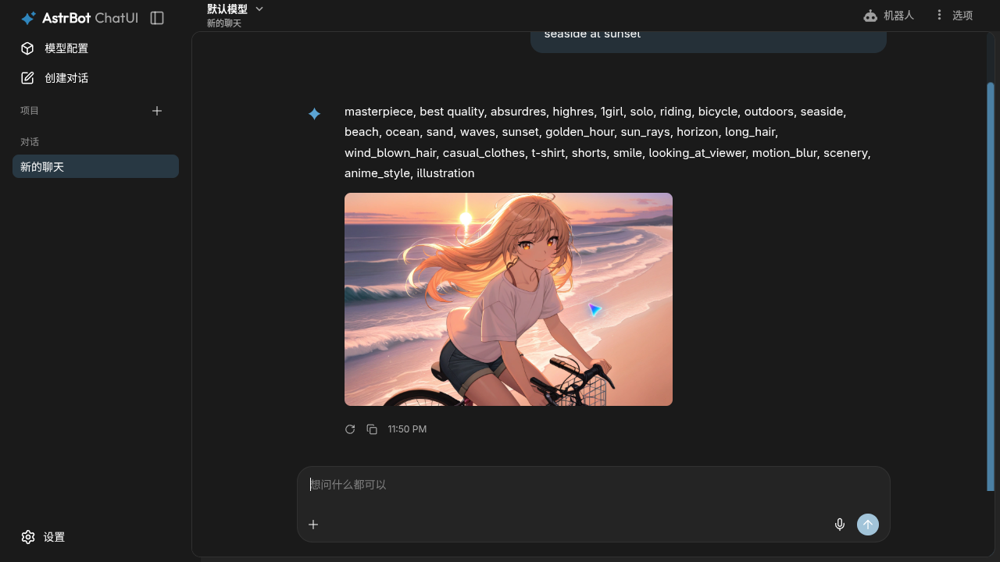

# astrbot_plugin_animeapi

Anime image generation for [AstrBot](https://github.com/AstrBotDevs/AstrBot), powered by [AnimeAPI](https://animeapi.ai), one of the cheapest anime image APIs: **$0.003 per image**, prepaid balance from $5 that never expires, no subscription. New accounts get 3 free images, no card needed.

[简体中文](README.md) · **English**



## Install

In the AstrBot WebUI open **Plugins → Install plugin → Install from link** and enter:

```
https://github.com/animeapi-ai/astrbot_plugin_animeapi
```

Then paste your API key (starts with `ank_`) into the plugin settings. Create one at <https://animeapi.ai/dashboard/api-keys>.

## Use

```
/anime a girl with a red umbrella at a rainy bus stop
/anime -o landscape a shrine in autumn, falling leaves
/anime -m ultra a cafe chalkboard that reads OPEN LATE
```

Write the prompt in plain words; AnimeAPI rewrites it into tags for the anime model. `/animeapi` is an alias.

## Settings

| Setting | Default | What it does |
| --- | --- | --- |
| `api_key` | empty | Your AnimeAPI key |
| `model` | `anime` | `anime` $0.003, `ultra` $0.01, `ultra-max` $0.02 per image |
| `orientation` | `portrait` | `portrait`, `square` or `landscape`; same price |
| `allow_nsfw` | **`false`** | NSFW output is off by default. Flagged images are refused and refunded instead of being sent to the chat |
| `enhance` | `true` | Rewrite plain prompts into tags (anime model) |
| `cooldown` | `30` | Seconds each user must wait between images; `0` disables the limit |
| `allow_model_override` | `false` | Let users choose a model with `-m`. Off so users cannot pick a more expensive model |
| `show_prompt` | `false` | Also send the tags the model received |
| `language` | `zh` | Reply language: `zh`, `en` or `ja` |
| `timeout` | `120` | Seconds to wait for AnimeAPI |

## Messages your users may see

| Situation | Reply |
| --- | --- |
| Balance is empty | Tells the bot owner to add funds at <https://animeapi.ai/dashboard/billing> |
| Key is wrong or revoked | Tells the bot owner to check the key |
| The model refused the prompt | Shows the reason; nothing is charged |
| Too soon after the last image | Shows how many seconds are left |
| AnimeAPI is busy | Asks to try again in a few seconds; failed images are refunded |

## Links

- AnimeAPI: <https://animeapi.ai> · [Docs](https://animeapi.ai/docs) · [API reference](https://animeapi.ai/docs/api-reference)
- Licence: [MIT](LICENSE)
